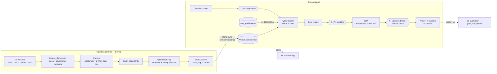

# 🏦 Enterprise Knowledge Assistant on Databricks

### Ask any policy, SOP or compliance question. Get a grounded answer, with its source — only from documents you're allowed to see.

A governed **RAG (Retrieval-Augmented Generation)** assistant for a financial-services firm, built end to end on **Databricks**: multi-format document parsing, hybrid chunking, hybrid (keyword + semantic) retrieval with reranking, four layers of guardrails, RAG evaluation and MLflow tracing.


-1B3139)


---

## 📌 Quick links
[Problem](#-the-problem) · [Architecture](#%EF%B8%8F-architecture) · [Guardrails](#%EF%B8%8F-four-layers-of-guardrails) · [Evaluation](#-evaluation) · [Run it](#-run-it-yourself) · [Roadmap](ROADMAP.md) · [Design decisions](docs/design-decisions.md)

---

## 🎯 The problem

A bank with many business units (compliance, operations, wealth management, asset servicing, risk, HR, technology) has a huge body of internal documents — SOPs, financial policies, complaints manuals, knowledge-base articles — spread across PDF, Word and HTML. Employees waste time searching them, and a generic chatbot is not acceptable because:

* answers must be **traceable** to a source document,
* employees must only see documents their **role and department** entitle them to,
* **PII** must never be sent to a model,
* the assistant must **not hallucinate** thresholds, deadlines or regulatory rules,
* it must resist **prompt injection**.

## 💡 The solution

| | Capability | How |
|---|---|---|
| 📄 | **Multi-format parsing** | `pdfplumber` / `pypdf`, `python-docx`, `BeautifulSoup`; `ai_parse_document` for scanned PDFs |
| ✂️ | **Hybrid chunking** | structure-aware → semantic breakpoints (sentence embeddings) → sliding window with overlap |
| 🔎 | **Hybrid retrieval** | Mosaic AI Vector Search `HYBRID` (BM25 + ANN); local BM25 + vector with Reciprocal Rank Fusion |
| 🥇 | **Reranking** | LLM listwise reranker (Foundation Model API); lexical reranker for CI |
| 🛡️ | **4 guardrails** | input filtration · PII masking · RBAC metadata filtering · output groundedness verification |
| 📎 | **Citations** | every answer lists doc id, title, section and file path |
| 📊 | **Evaluation** | hit rate, context precision/recall, MRR, answer correctness, refusal accuracy, LLM-as-judge |
| 🔭 | **Observability** | MLflow Tracing: one span per step (retrieve, rerank, LLM, guardrails) |
| ⏱️ | **Orchestration** | Databricks Asset Bundle + Job: ingest → chunk → sync index → evaluation quality gate |

---

## 🏗️ Architecture



**In simple words**
1. Documents land in a Unity Catalog **volume** and are loaded as bytes, with their business unit, category and access level, into `bronze_documents`.
2. Each format is parsed into sections → `silver_documents`.
3. Sections are cut into **chunks** (semantic + sliding window). Every chunk carries an `acl_tag` like `compliance:confidential`.
4. A **Vector Search Delta Sync index** embeds the chunks with `databricks-gte-large-en` and stays in sync through Change Data Feed.
5. A question passes the input guardrail, is searched with **hybrid search filtered to the user's entitlements**, reranked, PII-masked, answered by the LLM, then verified for groundedness before it is returned with citations.

---

## 🛡️ Four layers of guardrails

| # | Guardrail | Where | What it does |
|---|---|---|---|
| 1 | **Input filtration** | `guardrails.check_input` | Blocks prompt injection / jailbreak patterns (override instructions, reveal system prompt, role hijack, bypass access control, exfiltration, encoded payloads) before any retrieval runs |
| 2 | **PII masking** | `guardrails.mask_pii` | Redacts SSN, card numbers (Luhn-checked), email, phone, IBAN, account numbers, DOB in the question, the retrieved context and the answer — the LLM never sees raw PII |
| 3 | **RBAC** | `rbac.UserContext` | User entitlements (business units + clearance) become a Vector Search **filter**, so unauthorized chunks are never retrieved; re-checked after retrieval as defence in depth |
| 4 | **Output verification** | `guardrails.verify_answer` | Scores groundedness (every number must exist in the context; content-word support per sentence), rejects citations to documents that were not retrieved, and returns a refusal instead of an ungrounded answer |

Example — same question, two employees:

| User | Clearance | "What is the RTO for payments systems?" |
|---|---|---|
| `u_ops_manager` | operations · confidential | **4 hours** `[source: ops_bcp_runbook]` |
| `u_payments_ops` | operations · internal | *I don't know based on the documents you have access to.* |

---

## 📊 Evaluation

Golden set: **25 questions** in `data/eval/golden_questions.jsonl` — answerable questions with known source docs, questions the user is **not entitled** to, out-of-scope questions and prompt-injection attempts.

**Retriever, top 5 (offline run in CI — local BM25 + hashing embeddings, 80 chunks):**

| Mode | Hit rate | Context recall | MRR |
|---|:-:|:-:|:-:|
| Keyword (BM25) | 1.00 | 1.00 | 1.00 |
| Vector | 0.95 | 0.95 | 0.93 |
| **Hybrid (RRF)** | **1.00** | **1.00** | **0.97** |

**End to end (offline, deterministic stand-in LLM):** refusal accuracy **0.96** · citation accuracy **0.95** · groundedness **1.00**.

On Databricks, `05_evaluation` reruns the same set against the real Vector Search index (vector vs hybrid vs hybrid + LLM rerank), adds an **LLM-as-judge** faithfulness and relevance score, logs everything to MLflow and appends to `gold_eval_results`. The job **fails** if hybrid hit rate or refusal accuracy drop below 0.85.

---

## 🧰 Tech stack

| Layer | Technology |
|---|---|
| Platform | Databricks (serverless; Free Edition compatible), Unity Catalog |
| Storage | UC Volume (landing), Delta Lake (Bronze / Silver / Gold), Change Data Feed |
| Processing | Python, PySpark (`mapInPandas`) |
| Parsing | pdfplumber, pypdf, python-docx, BeautifulSoup, `ai_parse_document` |
| Embeddings | `databricks-gte-large-en` |
| Retrieval | Mosaic AI Vector Search (Delta Sync, `HYBRID` query) |
| LLM | Foundation Model APIs (`databricks-meta-llama-3-3-70b-instruct` by default; configurable, e.g. Claude Sonnet) |
| Observability / eval | MLflow Tracing, MLflow runs + tables |
| Deployment | Databricks Asset Bundles, Databricks Jobs, GitHub Actions CI |

## 📁 Project structure

```
databricks-enterprise-rag-assistant/
├── src/ekb/                     # testable Python package
│   ├── parsing.py               # PDF / DOCX / HTML / MD parsers
│   ├── chunking.py              # hybrid chunking (semantic + sliding window)
│   ├── retrieval.py             # BM25, RRF fusion, local + Databricks hybrid retrievers
│   ├── rerank.py                # lexical + LLM rerankers
│   ├── rbac.py                  # entitlements → acl_tag filter
│   ├── guardrails.py            # input filter, PII masking, output verification
│   ├── prompting.py             # citation-forcing prompt
│   ├── assistant.py             # orchestration + MLflow trace spans
│   ├── evaluation.py            # retriever + generation metrics, LLM judge
│   ├── llm.py                   # Foundation Model API clients (+ test double)
│   └── pipeline.py / config.py
├── notebooks/                   # Databricks notebooks (source format)
│   ├── 01_setup_and_ingest.py   # schema, volume, bronze_documents, entitlements
│   ├── 02_parse_and_chunk.py    # silver_documents, silver_chunks
│   ├── 03_vector_index.py       # Vector Search endpoint + Delta Sync index
│   ├── 04_assistant.py          # demo: citations, RBAC, guardrails
│   └── 05_evaluation.py         # metrics, LLM judge, MLflow, quality gate
├── data/
│   ├── raw/<business_unit>/     # 24 synthetic docs in 5 formats
│   ├── metadata/documents.csv   # business unit, category, access level, version
│   ├── rbac/user_entitlements.csv
│   └── eval/golden_questions.jsonl
├── tests/                       # 44 pytest tests incl. an offline end-to-end eval
├── resources/ekb_job.yml        # Databricks Job (bundle resource)
├── databricks.yml               # Databricks Asset Bundle
├── scripts/generate_corpus.py   # regenerates the sample corpus
└── docs/                        # design decisions, changelog
```

---

## 🚀 Run it yourself

**Locally (no Databricks needed):**
```bash
git clone https://github.com/Chandupolagoni/databricks-enterprise-rag-assistant.git
cd databricks-enterprise-rag-assistant
pip install -r requirements-dev.txt
pytest -q            # 44 tests, including an offline end-to-end RAG evaluation
```

**On Databricks** (a free [Databricks Free Edition](https://www.databricks.com/learn/free-edition) workspace works):
1. **Workspace → Create → Git folder**, paste this repo URL.
2. Run the notebooks in order: `01` → `02` → `03` → `04` → `05` (serverless compute).
3. Or deploy the job with the bundle:
   ```bash
   databricks bundle deploy -t dev
   databricks bundle run ekb_refresh_and_evaluate -t dev
   ```

> 💡 To use another LLM (for example a Claude Sonnet serving endpoint), set the `llm_endpoint` widget in `04`/`05` or the `EKB_LLM_ENDPOINT` environment variable.

---

## 📚 What I learned

* **Hybrid beats either alone** — exact tokens like "SR 11-7", "Fedwire" or "T+1" are where dense vectors are weakest and BM25 is strongest; RRF fuses them without score calibration.
* **RBAC belongs in the retriever, not the prompt.** Filtering at query time means unauthorized text never reaches the LLM, the citations or the traces.
* **Mask PII before generation**, not only in the output — the model, the logs and the traces all stay clean.
* **"I don't know" is a feature.** A strict prompt plus a numeric groundedness check turns hallucinations into refusals.
* **Evaluate the retriever and the generator separately** — most answer errors are retrieval errors.

## 🔮 What's next
See [ROADMAP.md](ROADMAP.md): GraphRAG over policy entities, incremental updates, an MCP tool server and multi-agent workflow, a Databricks App chat UI, Model Serving deployment and more.

---

## 👨‍💻 Author

**Chandrashekhar Polagoni** — Senior Data Engineer · Databricks · GenAI · RAG · Agentic AI

[](https://github.com/Chandupolagoni)

> All documents, people and the firm "Meridian Trust & Co." in this repository are fictional and generated for demonstration.
